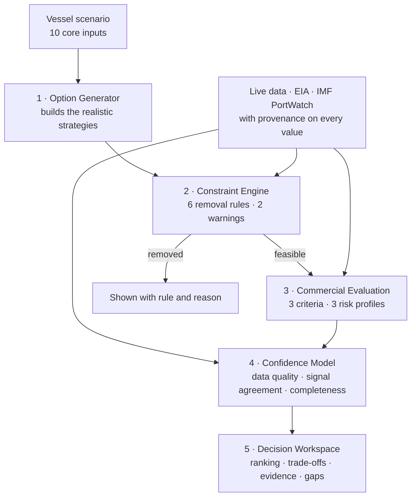

 ## How BrokerBrief decides

BrokerBrief works like a GPS for a commercial decision. It does not pick for you. It lays out the realistic routes, rules out the ones that cannot work, ranks the rest, and tells you how far to trust the ranking. The final call stays with the professional.

The first module answers a question bunker buyers and operators face on every voyage: **where, and how much, should this vessel bunker on the Singapore–Fujairah corridor?**

There is **no AI anywhere in the decision**. Every result traces back to a named rule, a visible weight or a dated, attributed data source, and the same inputs always produce the same answer.

### What the user gives it

| Required | Optional, but each one raises confidence |
|---|---|
| Fuel on board (MT) · daily consumption (MT/day) · required stem (MT) · fuel grade (VLSFO, MGO, IFO380, HSFO) · ETA to Singapore · ETA to Fujairah · schedule flexibility (hours) · origin and destination | Company safety reserve · fuel availability at each port · risk profile · preferred supplier |

### 1 · Option Generator: what could the vessel do?

The system writes the options itself, so a junior user still sees every commercially realistic choice:

- **Full stem in Singapore.** Removes fuel risk on the next leg.
- **Partial stem in Singapore, topped up in Fujairah.** The Singapore quantity is sized to reach Fujairah with 1.2× the safety reserve, never below a 200 MT minimum stem.
- **Full stem in Fujairah.** Delays bunkering in exchange for a possible price advantage.

### 2 · Constraint Engine: can this option physically and legally happen?

These rules are objective. They are not commercial opinions. An option that breaks one is removed, and the exact rule and figures are shown.

| Rule | Check | Effect |
|---|---|---|
| F1 | Can the vessel reach the port and still hold its safety reserve? The reserve defaults to the larger of 10% of fuel on board or 24 hours of consumption. | Remove, showing the shortfall in MT |
| F2 / C1 | Is the stem within the port's minimum and maximum stem size? | Remove |
| P1 | Is the required fuel grade available? Unknown keeps the option and lowers confidence. Confirmed unavailable removes it. | Remove or flag |
| R1 | Is HSFO being taken into a MARPOL Annex VI Emission Control Area? | Remove (illegal) |
| S1 | Do waiting plus bunkering hours exceed the schedule when there is zero flexibility? | Remove |
| S2 | Do port hours exceed the available flexibility? | Warn |
| F3 | Would the vessel depart below its safety reserve? | Warn |

Port time comes from waiting time plus bunkering time. Waiting time is estimated from live congestion: 4 hours when congestion is easing, 8 when stable and 18 when rising. Bunkering time is 8 hours in Singapore and 10 in Fujairah. If congestion is unknown, the system assumes 8 hours of waiting and says so.

### 3 · Commercial Evaluation: which feasible option is strongest?

Each surviving option is scored 0–100 on three criteria. The weights depend on the user's risk profile and are always shown.

| Criterion | Conservative | Balanced | Cost-focused |
|---|---|---|---|
| Expected fuel cost | 30% | 40% | 60% |
| Operational risk | 45% | 35% | 25% |
| Schedule risk | 25% | 25% | 15% |

- **Expected cost** compares the VLSFO price spread between the two ports. It then adjusts for the direction of crude: rising Brent favours bunkering now, softening Brent favours waiting.
- **Operational risk** follows live port-call trends from IMF PortWatch.
- **Schedule risk** measures the buffer left after the estimated port time. More than 12 hours of buffer scores highest.
- **Split stems carry an explicit penalty on every criterion**, because two port calls mean extra coordination, extra exposure to price moves and extra exposure to delay.

### 4 · Confidence Model: how far should you trust this ranking?

Confidence is scored separately from the ranking. Every deduction is itemised.

| Component | Weight | What lowers it |
|---|---|---|
| Data quality | 40% | Stale or missing Brent, missing forecast, missing congestion data, missing port prices |
| Signal agreement | 30% | Brent and Singapore VLSFO moving in opposite directions; Singapore and Fujairah prices diverging; congestion trends disagreeing between ports |
| Scenario completeness | 30% | Each of 10 inputs the user did not supply |

The result is labelled **High** (80 and above), **Medium** (60–79) or **Low** (below 60). If congestion is unknown at any port being scored, confidence is capped at Medium, whatever the other components say.

### 5 · Decision Workspace

The workspace shows:

- the ranked options, with each criterion's score and weight;
- the options that were removed, with the rule that removed them;
- every assumption the system made, labelled as an assumption;
- each data source with its date, licence and freshness.

Results can be exported as a PDF.

### Data: no source, no certainty

| Source | What it provides |
|---|---|
| EIA, Brent spot (series RBRTE) | Crude price level and direction |
| EIA Short-Term Energy Outlook | Forward Brent forecast |
| IMF PortWatch | Daily port calls (total, tanker, dry bulk) over 14 days for Singapore, Fujairah, Rotterdam, Houston and Port Hedland. A change of more than ±5% reads as rising or easing. |
| Analyst CSV or user input | Port bunker prices, tagged as manual entry or user override |

Every value carries seven provenance fields: source, URL, licence, quality tier, the date the source reports, the time BrokerBrief fetched it, and a maximum allowed age. Freshness is judged on the source's own date, not on when the value was fetched, so a week-old number fetched a second ago still counts as stale.

Missing data lowers confidence. It is never filled in, and it never removes an option that is physically feasible.

Licensed market data (Clarksons, Lloyd's List, Platts, Baltic Exchange and others) is never used in the deployed app.

### Built and tested

- Three built-in demo scenarios: both ports feasible, Fujairah unreachable on fuel, and a missing Fujairah price.
- Their results are pinned by automated tests, alongside 50 tests covering provenance, congestion handling and confidence caps.
- A Market Intelligence view (crude, port activity and bunker signals) with email, PDF and LinkedIn report formats.
- **In development:** a daily public morning brief, built from free and redistributable sources only.
