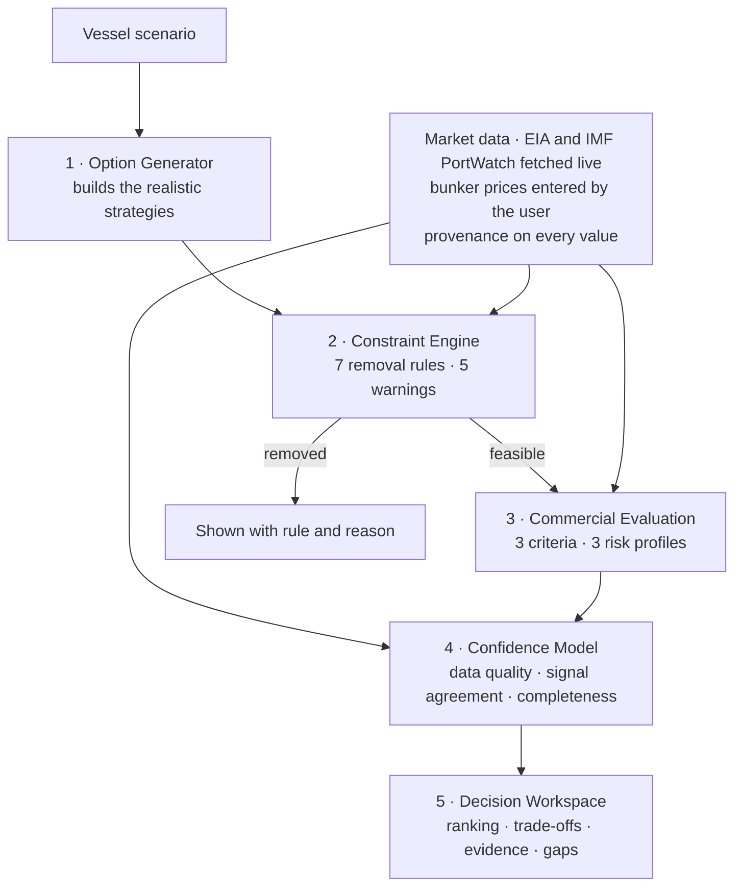

# BrokerBrief

https://brokerbrief-agyxesfh7xqqqxqqdqnyfx.streamlit.app/

## How BrokerBrief decides

BrokerBrief works like a GPS for a commercial decision. It does not pick for you. It lays out the realistic routes, rules out the ones that cannot work, ranks the rest, and tells you how far to trust the ranking. The final call stays with the professional.

The first module answers a question bunker buyers and operators face on every voyage: **where, and how much, should this vessel bunker on the Singapore–Fujairah corridor?**

There is **no AI anywhere in the decision**. Every result traces back to a named rule, a visible weight or a dated, attributed data source, and the same inputs and market data, evaluated on the same day, always produce the same answer. (Freshness depends on the date, so a price can turn stale overnight.)

### What the user gives it

| Required | Optional |
|---|---|
| Fuel on board (MT) · daily consumption (MT/day) · required stem (MT) · fuel grade (VLSFO, MGO or HSFO) · ETA to Singapore · ETA to Fujairah · schedule flexibility (hours) · origin and destination (labels only) | **Raise confidence when supplied:** company safety reserve · fuel availability at Singapore · fuel availability at Fujairah. **Change the result:** bunker price at each port (USD/MT) · scrubber fitted · voyage enters an emission control area · risk profile |

Bunker prices are entered by the user or uploaded as a CSV. There is no free, redistributable source of port bunker prices, so BrokerBrief never fills them in. Without them the tool still runs, and says plainly that it cannot weigh cost (see Confidence Model).

### 1 · Option Generator: what could the vessel do?

The system writes the options itself, so a junior user still sees every commercially realistic choice:

- **Full stem in Singapore.** Removes fuel risk on the next leg.
- **Partial stem in Singapore, topped up in Fujairah.** The Singapore quantity is sized to reach Fujairah with 1.2× the safety reserve, capped at 60% of the required stem and never below a 200 MT minimum stem. Because of the 60% cap it can fall short of that target, so rule F4 checks the Singapore-to-Fujairah leg.
- **Full stem in Fujairah.** Delays bunkering in exchange for a possible price advantage.

### 2 · Constraint Engine: can this option physically and legally happen?

These rules are objective. They are not commercial opinions. An option that breaks one is removed, and the exact rule and figures are shown.

| Rule | Check | Effect |
|---|---|---|
| F1 | Can the vessel reach the port and still hold its safety reserve? The reserve defaults to the larger of 10% of fuel on board or 24 hours of consumption. | Remove, showing the shortfall in MT |
| F2 / C1 | Is the stem within the port's minimum and maximum stem size? | Remove |
| P1 | Is the required fuel grade available at every port the option uses, including a split stem's top-up port? Unknown keeps the option and lowers confidence. Confirmed unavailable removes it. | Remove or flag |
| F4 | Can a split stem, after its Singapore part, cover the Singapore–Fujairah leg and still arrive with its safety reserve? | Remove, showing the shortfall in MT |
| R1 | Is the fuel HSFO (above 0.50% sulphur) on a vessel with no scrubber? MARPOL Annex VI regulation 14.1 prohibits using it, or carrying it for use, without an approved equivalent (regulation 4.1). The rule is about the ship, so it applies at every port. | Remove every option |
| S1 | Do waiting plus bunkering hours exceed the schedule when there is zero flexibility? | Remove |
| Tight-schedule warning | Do port hours exceed the available flexibility? | Warn |
| F3 | Would the vessel depart below its safety reserve? | Warn |
| Thin-reserve warning | Is the safety reserve in use under three days of consumption? The default (the larger of 10% of fuel on board or 24 hours of consumption) often is. | Warn |
| R2 | Is HSFO being burned through an open-loop scrubber at Singapore or Fujairah? Both ports prohibit open-loop wash-water discharge in port waters. | Warn |
| R3 | Does the voyage enter an emission control area? Fuel used inside must not exceed 0.10% sulphur (regulation 14.4). Without a scrubber approved as equivalent to 0.10% fuel, a VLSFO or HSFO stem cannot be burned on that leg. | Warn |

MARPOL limits the sulphur content of the fuel a ship uses and carries for use. It does not regulate what a port may sell, so no rule here removes an option because of where the fuel is bought. Regulation wording was checked on 12/11/2026 against IMO resolution MEPC.305(73) (regulations 14.1 and 14.4) and IMO's regulation 14 page (regulation 4.1 equivalents). The open-loop discharge bans at Singapore and Fujairah are taken from trade-press reports of the port notices, not from the notices themselves.

Port time comes from waiting time plus bunkering time. Waiting time is estimated from the PortWatch congestion signal: 4 hours when congestion is easing, 8 when stable and 18 when rising. Bunkering time is 8 hours in Singapore and 10 in Fujairah. If congestion is unknown, the system assumes 8 hours of waiting and says so.

### 3 · Commercial Evaluation: which feasible option is strongest?

Each surviving option is scored 0–100 on three criteria. The weights depend on the user's risk profile and are always shown.

| Criterion | Conservative | Balanced | Cost-focused |
|---|---|---|---|
| Expected fuel cost | 30% | 40% | 60% |
| Operational risk | 45% | 35% | 25% |
| Schedule risk | 25% | 25% | 15% |

- **Expected cost** compares the price of the selected fuel grade at the two ports; another grade's price is never substituted. It then adjusts for the direction of crude: rising Brent favours bunkering now, softening Brent favours waiting. A port with no price gets a neutral score.
- **Operational risk** follows port-call trends from IMF PortWatch. The congestion signal compares port calls at the start and end of PortWatch's latest window: a rough guide to waiting time, not a count of ships waiting.
- **Schedule risk** measures the buffer left after the estimated port time. More than 12 hours of buffer scores highest.
- **Split stems carry an explicit penalty on every criterion**, because two port calls mean extra coordination, extra exposure to price moves and extra exposure to delay.

### 4 · Confidence Model: how far should you trust this ranking?

Confidence is scored separately from the ranking. Every deduction is itemised.

| Component | Weight | What lowers it |
|---|---|---|
| Data quality | 40% | A missing input (Brent, forecast, congestion data, either port's price), or an input older than its own source's limit |
| Signal agreement | 30% | Brent and the Singapore price moving in opposite directions; Singapore and Fujairah prices diverging; congestion trends disagreeing between ports |
| Scenario completeness | 30% | Each of the three optional inputs not supplied: safety reserve, and fuel availability at each port |

The result is labelled **High** (80 and above), **Medium** (60–79) or **Low** (below 60).

**Freshness is judged per source.** EIA publishes daily Brent prices once a week, so a value up to 10 days old is normal and costs nothing; older than that, it is stale and costs 15 points. PortWatch's limit is 14 days, because its data arrives 8–10 days behind. A bunker price loaded from a CSV is stale after 48 hours (a placeholder until a refresh routine exists); a typed price has no age to judge. Where a source gives no date (the EIA forecast, or a CSV date that cannot be read), freshness is shown as unknown and nothing is deducted. Dates in a CSV are read as year-month-day or day/month/year, never month/day/year.

**Three caps override the score**, because some gaps make a high label indefensible:

| Gap | Confidence is capped at |
|---|---|
| Congestion unknown at any port being scored | Medium |
| No price at one port being scored | Medium |
| No price at any port being scored | Low |

### 5 · Decision Workspace

The workspace shows:

- the ranked options, with each criterion's score and weight;
- the options that were removed, with the rule that removed them;
- the assumptions behind the result, listed as assumptions (including the default safety reserve and any assumed waiting time);
- each input's source, the date the source reports, its licence and its freshness.

### Data: no source, no certainty

BrokerBrief is built on two principles. **No source, no certainty:** every value carries its source and date, and missing data is flagged, never invented. **Runs unattended:** the data refresh and the morning brief are being built to run on a schedule with no manual step, to mark a section empty with the reason when a feed breaks, and to raise an alert when a run fails (in development; not yet live).

| Source | What it provides |
|---|---|
| EIA, Brent spot (series RBRTE) | Crude price level and direction. Fetched from the EIA API. |
| EIA Short-Term Energy Outlook | Forward Brent forecast. Fetched from the EIA API. |
| IMF PortWatch | Daily port calls (total, tanker, dry bulk) over 14 days for Singapore, Fujairah, Rotterdam, Houston and Port Hedland. A change of more than ±5% reads as rising or easing. Fetched from PortWatch. |
| User input or uploaded CSV | Port bunker prices, tagged as user override or manual entry |
| Built-in demo data | Invented values, labelled "SAMPLE — not real data" everywhere they appear. Loaded only on request (a demo scenario, or the "Load demo data" buttons), and never used by Market Intelligence or the morning brief. |

When an EIA key is configured on the server (Streamlit secrets or the `EIA_API_KEY` variable), the app fetches EIA and PortWatch data itself, shares each result across visitors for up to three hours, and holds a failed fetch for five minutes before retrying. The key never reaches the browser. Without a server key, a local user can paste one in the sidebar.

Every value carries seven provenance fields: source, URL, licence, quality tier, the date the source reports, the time BrokerBrief fetched it, and a maximum allowed age. Freshness is judged on the source's own date, not on when the value was fetched, so a week-old number fetched a second ago still counts as stale.

Missing data lowers confidence. It is never filled in, and it never removes an option that is physically feasible.

Licensed market data or paid sources are never used in the deployed app.

### Built and tested

- Three built-in demo scenarios, on invented prices with flat Brent and stable congestion. The voyage is a tanker in ballast from Zhoushan to Ras Tanura, one day from Singapore and 11.5 days from Fujairah, burning 45 MT/day and needing a 1,000 MT VLSFO stem:

  | Scenario | Fuel on board | Result | Confidence |
  |---|---|---|---|
  | 1. Both ports feasible | 900 MT | Full stem in Fujairah ranks first (74.1), ahead of full Singapore (66.3) and the split stem (57.2) | High, 91 |
  | 2. Fujairah unreachable | 280 MT | Full Fujairah removed by rule F1. Full Singapore ranks first (66.3); the split stem takes 291.5 MT in Singapore (57.2) | High, 91 |
  | 3. Fujairah price missing | 900 MT | Full Singapore ranks first (69.0), ahead of full Fujairah (67.0) | Medium, 79 (85 before the missing-price cap) |

- These results are pinned by `tests/test_demo_mode.py`. The rules, the grade-specific prices, the freshness limits and the caps are covered by `tests/test_decision_rules.py`, and the page itself by `tests/test_ui_bunkering_page.py`. Run `pytest -q` to check every figure above.
- A Market Intelligence view (crude, port activity and bunker signals) with email, PDF and LinkedIn report formats.
- **In development:** a daily public morning brief, built from free and redistributable sources only.
